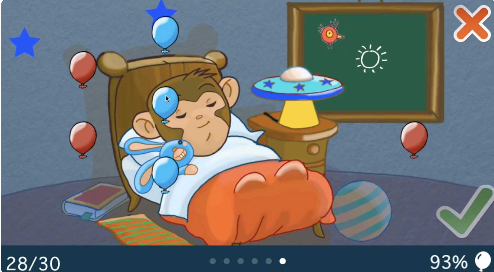

# Bedtime Balloons

A gamified bedtime routine for kids, with sprite animations, timers and background notifications. My second iOS app, built in Objective-C with cocos2d.

<!-- Hero still: the reward moment. Replace with a short GIF at assets/bedtime-balloons.gif if you record one; keep the video thumbnail as the full demo. -->

**Role:** designer, developer, QA, release, and marketing (solo) · **Built:** 2011–2014 · **Studio:** Round Trip Software
**Stack:** Objective-C, UIKit, cocos2d, Core Data, AVFoundation · **Status:** no longer on the App Store

- [Demo video](https://youtu.be/P_HLeBcKXtE?si=k36kmfskB4IFzfiu)
- [More info on the Round Trip Software site](https://roundtripsoftware.wordpress.com/bedtime-balloons/)

## The idea

My kids were little and getting them to bed was a nightmare: they got hyper and unfocused. I built this app to help them focus on what to do next and to make bedtime fun, with small rewards built in.

On the technical side, I wanted to get into interactive animation and original characters.

## What it does

- Build bedtime routines from tasks, using a step-by-step wizard for creating a new routine
- Customize tasks with your own images and set a time range for each one with a double-ended slider
- Reorder routines and tasks by dragging
- Run a routine as a game: animated balloon and villain characters (the villain is a pesky bug), with pop sound effects
- Keep going in the background with local notifications
- Protect settings from small hands with a parental gate
- Available in English, with an unfinished German localization

**How it plays:** Each step of the routine (brushing teeth, getting dressed, and so on) shows a friendly animated monkey doing that activity, with an optional animated timer. Balloons float across the top of the screen, and a pesky bug flies around and pops them one at a time as the time runs out. If the child finishes the step in time, they keep the balloons that are left and pop them with a finger as a reward.

## How it's built

- **About 13,000 lines of my own Objective-C**, on top of the open-source cocos2d engine and a few third-party UI components (listed below).
- **cocos2d for the game layer.** Balloon and villain sprites and the routine animations run in a cocos2d scene hosted inside a regular UIKit app, so the game screens and the settings screens live together.
- **Core Data** for routines, tasks and customizations, behind a small data-access layer.
- **Audio** through AVFoundation and CocosDenshion.
- **Timers and local notifications**, so a routine keeps working when the app isn't on screen.
- **Native UIKit for everything else:** collection views, wizard screens, image picking and editing, iPhone and iPad layouts.
- **Early-era constraints:** targets iOS 6.1 and 7.0, from before SpriteKit and Swift existed. The file headers date from late 2011 through 2014.

### Third-party code in this repo

cocos2d, CocosDenshion, kazmath, NMRangeSlider, ELCImagePicker, DraggableCollectionView and ADVPercentProgressBar. See their own licenses.

## What I learned

Simpler projects can be more useful than ambitious ones, and building on a third-party animation framework (cocos2d) means its changes can break your app. [Read my retrospective](https://mentalbreaktown.blog/2022/04/11/what-you-can-see-here-is-that-i-was-learning/).

## Screenshots

